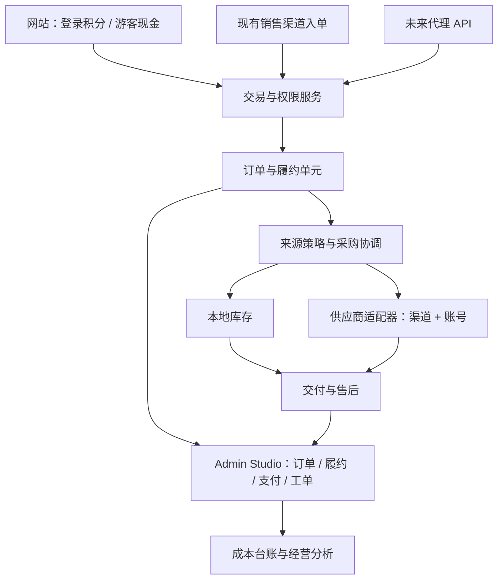

# 商城供应链与代理开放平台 2.0 计划

- 制定日期：2026-10-19。
- 状态：规划稿，待分阶段实施；本文不代表供应商购买能力或代理 API 已上线。
- 代码核对基线：`e9db00863fddaaab782c00aef14bb1bd21040314`。制定时已执行 `git fetch origin main`，`HEAD..origin/main` 为 `0`，HEAD 与 origin/main 相同。
- 本轮范围：现状核对、产品设计、实施拆分、验收标准。没有使用商户凭据、创建真实采购单、执行 SQL、修改运行代码、推送或部署。
- 本文是新增的 2.0 规划，不改写原供应商架构文档和既有验收档案；旧档案中的执行结果继续保留。

## 1. 产品目标与首期取舍

目标是让一件外部货源商品，从导入、定价、售卖、采购、交付到退款与经营复盘，都能在现有商城和 Admin Studio 中处理。以后接入另一家供应商，主要新增适配器、账号和商品映射；代理调用我们的 API，也复用同一套交易与履约能力。

2.0 首期必须形成的操作闭环：

> 连接供应商 → 导入商品草稿 → 配置规格、售价与货源 → 服务端可售检查 → 用户付款/积分扣款 → 按单采购 → 安全交付 → 异常核对或售后结案 → 成本、收益与告警回写。

代理 API 在 2.0 中完成领域边界和契约准备，正式开放作为后续独立阶段。供应商自动采购不能以代理门户开发完成为前提。

| 2.0 必做 | 提前准备，按阶段开放 | 首期暂缓 |
| --- | --- | --- |
| 虾仁渠道的标准自动发货商品，固定规格映射 | 多供应商、多商户账号、主备映射 | 复杂自定义表单、预选卡、手工充值服务 |
| 登录用户积分购买与游客现金购买分别接通 | 代理身份、订单归属、独立结算边界 | 多级代理、授信、账期与复杂佣金体系 |
| 采购未知结果、对账、退款、人工结案 | 代理 API v1 契约、签名、幂等与回调 | 动态竞价、全自动最优渠道路由 |
| 订单、履约、库存、支付、工单、经营分析联动 | 同商品多来源的确定性切换 | 自动囤货、自动给供应商充值 |
| 实际成本、估算成本和待核对成本分别展示 | 逐项扩展多件采购、混合购物车 | 同一件商品并行向多家上游采购 |

**首批建议范围：国内站、少量运营选定的自动发货 SKU、每单一件、不含复杂附加参数。** 上游起购量大于一、规格无法准确映射、交付内容无法可靠识别的商品暂不开放。现有本地商品的购物车、多件和支付路径继续按现行规则工作。

## 2. 当前能力与缺口

下表是代码核对结果，不能替代生产数据库和真实上游联调证据。来源编号见第 16 节。

| 能力 | 当前情况 | 2.0 补充 |
| --- | --- | --- |
| 供应商适配层 | 已有能力契约、注册表、16688 客户端和 `outcomeUnknown` 错误语义〔B1–B3〕 | 新增虾仁适配器；能力描述增加幂等恢复、规格、异步交付等语义 |
| 多账号 | 已有供应商账号表和 `credential_ref`；运行工厂仍按环境配置构造 16688 实例〔B2、B4〕 | 按 provider + account 解析实例、凭据和限额；不能只按 provider 缓存客户端 |
| 供应商目录 | 已有查询、预览、最多 20 项草稿导入；UI 固定 16688〔B5、B6〕 | 从能力目录读取供应商/账号选项，增加规格映射与可售检查 |
| 商品映射 | 已有本地商品/SKU 到上游货号的关系；现有唯一约束仅到账号、站点、货号〔B4〕 | 增加稳定的上游变体身份，支持一个货号的多个规格；迁移不能丢失旧关系 |
| 本地库存与采购 | 已有库存来源、采购批次、成本质量和销售关联；采购概览位于库存工作区〔B7〕 | 追加“按单采购”视图，与“入库批次”区分；上游参考库存不能成为本地库存 |
| 登录购买 | 已有积分购买 RPC、折扣和积分来源追溯〔B8、B9〕 | 增加外采下单事务：扣款、订单、履约指令一起落库；不在事务内访问上游 |
| 游客现金购买 | 使用独立订单、支付和 worker 流程；当前可购校验要求 KEY 且非人工发货〔B10、B11〕 | 显式扩展受控的外采履约资格和数据库门禁；只改前端或开商品开关不够 |
| API 履约 | 当前主要围绕 `shop_webhook_tasks`、重试、死信、锁与人工操作〔B12〕 | 增加供应商采购任务类型和对应动作权限；不能把未知采购当普通 webhook 重放 |
| 销售渠道 | 已有 marketplace 渠道、账号、外部单号和 token 入单接口〔B13〕 | 保留为销售来源；它不是完整的代理鉴权、扣款和结算 API |
| 售后与经营 | 已有退款、工单、订单联动、利润台账和经营中心〔B9、B14〕 | 接入外采状态、实际成本、对客处理与上游追偿；复用入口和事实口径 |

原文档记录了负责人于 2026-10-07 应用基础迁移。这是历史记录，本轮没有连接生产库核验，不能把后续新增表或迁移标成已应用。原文档关于 16688 开放状态的记载也不作为其当前可用性的证明。

## 3. 三个维度分开，同一条交易链联动

- **销售渠道**：网站、闲鱼、未来代理 API。回答订单从哪里来、属于哪个客户或代理。
- **支付方式**：游客支付宝/USDT、登录用户积分、未来代理预存款。回答谁支付、如何确认、如何退回。
- **供货来源**：本地库存、虾仁账号 A、另一家供应商账号 B。回答货从哪里来、采购成本是多少。

三个维度分别保存，不能把“USDT”当供应商，也不能把“代理”当供应商账号。订单收入按真实销售渠道归因，采购成本按真实供货账号归因。

保持现有游客订单、积分订单及其权限隔离，通过统一的履约服务和展示投影联动；不为统一界面而重写所有历史订单表。TG、KC 和 NewAPI 维持各自现有边界，本计划不迁移这些系统的订单或密钥。

## 4. Admin Studio 信息架构与跨板块闭环

### 4.1 沿用现有入口

不新增一排“供应链、采购中心、代理中心、对账中心”等平行侧栏。首期使用现有工作区、抽屉和筛选深链。

| 现有位置 | 调整后的内容 | 日常默认展示 |
| --- | --- | --- |
| 商城 → 供应商目录 | 目录 + 账号管理入口；账号配置放抽屉 | 供应商/账号、站点、搜索、参考库存/成本、规格、导入 |
| 商城 → 商品 | 商品编辑增加折叠的“货源与交付” | 来源方式、映射是否完整、可售检查、上架条件 |
| 商城 → 库存 | 保留本地库存和采购成本概览；增加“入库批次 / 按单采购”切换 | 自有库存是真实库存；外采是采购记录与参考可售状态 |
| 商城 → 订单 / 游客异常 | 同一套采购摘要与异常动作投影 | 支付、履约、来源、异常原因和一个主操作 |
| 商城 → API 履约 | 扩展为“履约”，保留旧 tab/deep link 兼容 | 本地 API 任务 / 外部采购任务；超时、待核对、失败等筛选 |
| 支付对账 | 关联商城订单、用户扣款和退款记录 | 对客收付结果；采购扣费作为关联信息 |
| 售后工单 / 客服消息 | 带订单与采购上下文，可跳回处理 | 问题类型、客户诉求、公共说明、内部备注、处理结果 |
| 用户管理 / 积分流水 | 关联积分来源、商品订单、退回与奖励 | 原支付构成、退回构成和关联单号 |
| 经营分析中心 / 运营保障 | 加入供应商维度和可处理异常 | 供货成本、毛利、交付质量、待核对敞口；点击进入对应列表 |
| 系统设置 / 审计 | 供应商连接、凭据状态、操作权限与变更记录 | 已配置/未配置、最后校验时间；不显示密钥值 |

后续开放代理 API 时，在既有销售渠道设置中增加代理接入管理入口，采用列表 + 详情抽屉；代理数量和运营复杂度确实需要时，再考虑独立模块。

### 4.2 每个业务动作必须有去向和回写

| 触发 | 操作入口 | 必须联动的记录 | 完成标准 |
| --- | --- | --- | --- |
| 接通上游 | 供应商目录 → 连接账号 | 账号、凭据引用、能力、只读校验、审计 | 只读可用与允许新采购分开；测试连接不产生消费 |
| 导入商品 | 目录预览 → 导入草稿 | 商品、规格、来源映射 | 草稿下架、映射禁用；重复导入不覆盖运营内容 |
| 准备售卖 | 商品 → 货源与交付 | 站点、售价、采购限价、可售检查、启用范围 | 缺一项即显示具体阻塞项；开关操作单独审计 |
| 用户下单 | 商城详情 → 原确认流程 | 服务端报价、订单、支付或积分扣款、履约指令 | 确认页金额与服务端快照一致，两种购买路径都有验收 |
| 支付成功 | 支付事件 / 积分扣款事务 | 原订单、待采购单元、资金预算占用 | 重复通知只形成一次扣款与一次有效采购意图 |
| 正常交付 | worker → 交付服务 | 采购回执、加密交付物、订单、成本、奖励事件 | 管理员和用户展示一致；重复查询不重复购买 |
| 结果不明 | 订单详情 / 履约 → 核对 | 原请求号、原上游单、查询结果、责任人、下次动作 | 可继续查单、补录、提交凭据；不出现只能一直点关闭的死路 |
| 采购确定失败 | 订单详情 → 处理 | 失败依据、是否允许备选、退款或人工方案 | 退回结果可查、客户看得见，不留下无主任务 |
| 卡密售后 | 工单 → 关联订单 | 交付物指纹、展示记录、上游售后、补偿记录 | 补发与原采购有关系，不能绕过未决采购再次扣费 |
| 退款完成 | 支付/积分处理 → 回写 | 对客退款、优惠/奖励、利润修正、客户说明 | 原途径退回或人工凭据确认，重复处理不重复退款 |
| 日常经营 | 经营中心 → 异常或商品 | 精确筛选的订单、采购、工单列表 | 处理后回原视角；统计状态按同一事实更新 |

### 4.3 订单详情保持清晰

默认四块：订单与支付、交付进度、采购摘要、售后与处理记录。完整上游请求和技术诊断放有权限的详情抽屉。底部只保留当前可执行的主操作，其他动作收进菜单。

可执行动作必须由服务端根据状态和证据返回，按钮禁用时同时给出阻塞原因与下一步。后台列表不展示完整卡密、密钥、原始请求或上游资金余额。

复用当前自定义下拉、轻量 hover、单层聚焦边框、主题和移动端布局；骨架与最终抽屉/弹窗的宽度、区块一致，操作反馈自动消退。此项限定在新增或调整的界面，不批量改造全站按钮。

## 5. 商品、规格与可售能力

### 5.1 一个本地 SKU，可以挂多个合格来源

本地商品标题、图片、分类、使用说明、售后说明、售价和上下架由运营控制。上游同步只更新供应商字段、参考状态、规格变更和检查结果，不静默修改本地售价，也不重新上架。

映射包含：站点、本地商品/SKU、provider、account、上游商品编码、稳定的变体键、规范化规格、采购参数模板、优先级、启用状态和版本。变体键由排序后的规范化规格计算，不能用界面排列位置或临时名称作为唯一身份。

现有 `(supplier_account_id, site, supplier_goods_no)` 唯一约束需要做兼容迁移，纳入变体身份；旧无规格映射归入稳定的默认变体。迁移先检查重复、保留原 ID 和引用，再调整约束。映射关系身份和目录导入去重规则要分别定义，防止重复导入和误合并规格。

不同来源只有在商品权益、规格、有效期、地区限制、交付形态和售后条件等价时，才允许作为同一个 SKU 的主备来源；无法确认等价的建立独立 SKU。

### 5.2 可售检查不是锁库存

可售检查必须在服务端完成：本地启用与购买资格、规格与数量、渠道状态、真实报价与币种、交付能力、成本上限、资金证据和采购预算。

- 浏览目录可以使用短期参考缓存；创建订单使用针对当前数量、规格和账号的询价快照。
- 报价快照绑定站点、购买人/代理、SKU、数量、来源候选、费用、汇率来源、限价、策略版本和有效期；客户端只能提交引用，不能提交采购价或供应商账号作为授权。
- 建议预检报价有效期初始设为 60 秒，最终按上游实测调整。报价过期重新确认；支付订单已经创建后，用户应付金额保持原快照。
- 当前按映射保存的 `shop_supplier_availability` 只用于参考状态；不能把数量一的价格当数量十的正式报价，也不能跨账号、币种、会员等级复用。
- 上游库存不写入 `shop_inventory`，也不直接累加进本地 `stock_count`。前台展示规范化的“可购买 / 暂不可用”，必要时保守展示参考数量。
- 账号不提供余额 API 时明确标为“不支持/待核验”，不能伪造 `balance_enough=true`。采用何种资金证据、有效期和风险限额必须在首发验收中确定；没有可信方式的 SKU 保持关闭。
- 每账号设并发上限、单笔限额和未决采购预算；预算占用必须在数据库原子计算。未知采购继续占用风险额度，不能因 HTTP 超时自动释放。

## 6. 来源选择与首发购买流程

### 6.1 来源策略简单、确定、可解释

商品支持三种策略，默认只配置一种：本地库存、指定外采、本地优先后外采。首批外采商品采用“指定外采”，减少上线变量；已有本地商品不因新增供应商自动获得外采能力。

“本地优先后外采”在后续阶段开放：下单时本地有可预留库存则走原本地事务；没有才进入外采检查。命中本地路径后，外采不能同时执行。对已支付订单，不得因配置变化同时开启两个来源任务。

多来源按运营设置的优先级选择，稳定 ID 作为同优先级的排序补充。首期不自动选择最低价；预检时筛掉不满足限价、能力、库存或资金门禁的候选。

支付后采购前再次确认成本和资格。允许在事先记录的采购成本上限内继续；超过上限转异常处理，不追加向用户收费。来源停用时，禁止新采购与保留查单/售后分别控制；不能因关账号而失去旧单核对能力。

### 6.2 两条现有购买路径都接通

| 路径 | 提交前 | 确认收款时 | 后续 |
| --- | --- | --- | --- |
| 登录积分购买 | 服务端验证登录与价格；记录付费/赠送积分、优惠构成与采购报价 | 在本地事务内扣款、创建订单与履约指令；失败一起回滚 | 事务提交后采购；订单进入处理中；退回按原构成恢复 |
| 游客现金购买 | 沿用订单查询凭证、站点和渠道校验；增加明确的外采资格门禁 | 服务端核验真实支付事件，原子标记已收款并产生履约指令 | 采购与交付复用协调层；现金退款沿用渠道及人工核对规则 |
| 未来代理购买 | 校验代理、商品范围、报价和余额 | 原子占用/扣记代理资金并创建订单与履约指令 | 同一采购引擎；独立资金台账和可见范围 |

登录状态处于加载或异常时保留明确状态，不能自动当游客或直接显示积分兑换。刷新、跨页面进入、购物车和详情购买必须读取同一购买能力判断。

**不能直接套用现有同步扣积分取本地卡密的 RPC。** 外采分支需要对应的原子下单/扣款契约，网络请求放在事务外；既有本地购买继续使用其成熟路径。

首批外采商品先从商品详情完成单件购买。购物车对暂不支持的外采/混合组合在付款前说明限制并引导单独购买，不静默丢弃商品或把登录用户强制送入游客现金路径。后续多件与混合购物车以订单项/履约单元为粒度扩展，部分交付不能被父订单误标为全部成功。

### 6.3 取消、过期与迟到支付

未支付且没有有效采购指令时可取消，原子关闭订单并释放本地预留和预算；不能只改页面状态。支付事件与取消并发时由数据库条件更新裁定，取消不能覆盖已确认收款。

过期后收到真实付款仍须登记收款事实，进入核对/退款或重新验证履约资格，不能忽略到账，也不能照着过期报价直接外采。停开新商品、账号或整个采购功能后，旧单的查单、交付、退款和审计仍应可用。

## 7. 状态模型、未知结果与人工结案

### 7.1 分开保存状态，统一对用户解释

下列名称为目标领域语义，实施时映射现有字段并新增必要字段，不批量改名历史状态。

| 维度 | 典型状态 | 不能混淆的事实 |
| --- | --- | --- |
| 对客支付 | 待支付、已支付、需核对、退款中、已退款 | 上游采购失败不能把对客“已支付”改成未支付 |
| 采购 | 待提交、提交中、已受理、已取得交付物、明确拒绝、结果未知 | 已受理/已扣费不代表已发货；查不到不代表未受理 |
| 对客交付 | 未开始、处理中、部分交付、已交付、受阻、已终止 | 有文本或卡密尾数不等于完成有效交付 |
| 售后/结案 | 无、处理中、已解决 | 对客问题解决，不等于上游追偿已完成 |
| 核对与风险 | 无未决、待核对、有损失敞口 | 退款给用户后，仍可能存在上游未明扣费 |

### 7.2 不同情况对应不同动作

| 当前证据 | 可以执行 | 需要保留的约束 |
| --- | --- | --- |
| 请求尚未发送 | 取消采购、退回资金、重新选择合格来源 | 原指令作废和新指令创建必须防并发 |
| 上游明确拒绝，确认无受理/无扣费 | 在原成本上限内尝试已配置备选，或退款结案 | 保存拒绝凭据；不得把普通报错文本当成无副作用证明 |
| 已有上游单号且已受理 | 查询原单、等待交付、登记上游售后 | 不重复采购，不因超时自动切源 |
| 创建超时、断连、响应丢失或无法解析 | 进入结果未知；核对原请求号和原单 | 锁定同一采购意图；查无结果、锁过期均不足以重买 |
| 已取得合法交付物但本地落库失败 | 恢复同一采购结果，再幂等落库与交付 | 不创建新采购单 |
| 已交付后卡密异常 | 工单核验、供应商售后、授权补偿 | 新补发是关联的售后单元，不能伪装为原请求重试 |

未知结果可按 15 秒、30 秒、60 秒退避查询，后续降低频率；具体节奏遵守上游限流。建议等待 5 分钟触发运营告警并分派负责人，此时只升级处理优先级，不推断采购失败。无有效查询标识时直接进入人工核对队列，不空转重试。

### 7.3 人工处理要能真正走完

订单详情提供三条明确路径：

1. **补录并核验原上游单**：填写上游单号，服务端从该账号查询并核对商品、规格、数量、金额等可验证字段；不能把其他订单的卡密挂过来。缺失关键字段需明确标记人工证据和权限，不能冒称自动核验成功。
2. **登记明确未受理/已撤销依据**：保存来源、时间、关联账号/请求号、凭据引用及操作者；确认满足安全条件后才允许备选采购或无货退款结案。
3. **对客补偿结案并继续追偿**：业务决定先退还/补偿客户时，登记已完成的补偿证据、公开完结说明、内部备注和负责人；终止进一步自动采购，仍保留上游未决风险和追偿任务，不把采购状态改成“明确失败”。

对客显示示例：`已完结 · 未交付，已退款`，并显示管理员提供的公开说明；成功交付则显示 `已完成 · 已交付`。任何“完结”按钮都必须明确是哪种结果，不能用“已发货”掩盖人工结案。公开说明与内部备注分字段、分权限，用户接口只返回公开内容。

人工动作使用持久的操作号：超时后查询同一操作结果，再决定是否重试同一次操作；刷新后仍能恢复。不能只锁住输入框而不给结果查询、接管或证据补录入口。订单、工单、用户查询和经营指标读取同一处理结果。

退款/补偿与交付并发时，由数据库状态版本和条件更新裁定，交付接口再次校验对客结果。客户已退款结案后，上游迟到成功仍记录真实扣费与加密交付物，但进入待处置队列，不自动发给客户或重新入库售卖；由授权人员核定追偿、报损或可复用库存，保留交付物唯一归属和完整审计。

## 8. 履约引擎与数据改造

### 8.1 延伸现有系统，保持最小必要模型

名称为建议，实施前用契约明确字段和唯一约束。首期不引入微服务、独立消息中间件或通用工作流平台。

| 数据对象 | 方式 | 核心责任 |
| --- | --- | --- |
| 供应商账号、商品映射、可售参考 | 扩展现有三张供应商表 | 多账号、能力版本、规格映射、新采购开关、参考状态 |
| 履约单元 | 新增轻量模型 | 关联一个订单项和数量；记录来源、交付状态、公共处理结果 |
| 下单报价快照 | 在既有订单快照/受保护的报价记录中扩展 | 固定售价、成本上限、候选来源和策略版本；不能依赖可变缓存 |
| 采购主记录 | 新增 | 采购意图、账号、原请求号、上游单号、受理/未知状态、实际成本、未决敞口 |
| 采购尝试与核对记录 | 新增 | 创建、查单、同请求恢复、人工凭据和状态变化；保留追加历史 |
| 持久履约任务 | 新增数据库任务表或经契约验证的通用 outbox | 支付/扣款与待执行指令原子提交；租约、下次执行、任务类型和判重 |
| 交付物 | 复用现有加密、授权与审计能力，补外采关联 | 加密内容、指纹、所属订单项、展示/复制记录和唯一归属 |
| 成本利润、审计、工单、通知 | 扩展既有模型 | 采购成本与对客收付分开；按事件幂等入账和关联 |
| 代理身份、API key、代理余额及定价 | 后续独立增加 | 2.0 先确定归属与接口；开放前再落完整管理能力 |

游客订单与积分订单的关联必须有可验证的外键/桥接约束和唯一性，保证一个履约单元只属于一条真实销售订单。不能只使用无约束的 `order_type + 任意 order_id` 而绕过授权和归属检查。

首批单件采购下，一个履约单元至多存在一笔未决或成功的有效采购。明确失败后的备选是新尝试，关联原失败证据；未知尝试不能与新有效采购并存。未来多件逐单元扩展，不放松这个约束。采购主记录对 `(账号, 原请求号)` 和非空的 `(账号, 上游订单号)` 分别设唯一约束，尝试记录引用同一主记录；交付物保留唯一归属，防止同一原单被补录到两笔销售订单。

### 8.2 防重复和故障恢复

- 本地扣款/支付确认、履约单元和 outbox 同事务提交； worker 可重复领取，但外部副作用不能任意重放。
- 请求号在网络调用前持久化。同一采购意图的恢复始终使用同一请求号和相同参数摘要，不能每次重试生成新号。
- DB 唯一约束与条件更新负责资金、采购和交付判重；Redis 限流或前端按钮锁不能代替。
- 任务使用租约与 fencing/version 校验。租约过期只授权接管核对，不自动认定前一次 HTTP 没有成功；迟到响应保留为原采购的证据，再由当前状态协调落库。
- 创建请求一旦可能到达上游，除非证明其幂等恢复语义可用，否则走查询或人工核对。供应商明确不支持幂等时，禁止自动重放有副作用请求。
- “重查原单”“按已证明的同请求恢复”“发起新的售后补发”是不同权限和动作，不共用普通 `requeue` 的业务含义。
- 回执、金额和交付物规范化后再确认成功。上游 `paid`、任意非空 `secret`、HTTP 200 或 `code=200` 都不能单独成为交付完成标准。
- 映射、报价、账号、策略和参数模板在采购尝试中保存版本快照。修改配置只影响允许受影响的未来动作，不改写历史。
- 不承诺跨系统绝对“恰好一次”。以持久幂等、有限副作用重放和未知结果核对降低风险，并明确记录无法自动证明的情况。

### 8.3 兼容与历史数据

新增能力默认关闭；旧 KEY/API、本地库存、游客订单、积分订单和 marketplace 入单必须保留各自语义。不得把既有 `delivery_type=API` 一律解释成外采，或把新 `supplier` 字符串直接塞进旧约束。

历史订单不因增加映射自动采购；历史缺成本标记为未知或估算，不能补成零。存量异常若需接入新处理流程，由显式、可审计的历史认领动作建立关联，不触发真实采购。

## 9. 定价、资金、营销和利润联动

### 9.1 售价与采购成本分别冻结

正式询价须明确价格是单价还是总价、原币种、计价精度、会员价、批量价、附加费、实际扣款口径和汇率来源。虾仁这些口径未完成真实联调前，不依赖页面展示币种推断结算币种。

客户支付快照、采购原币金额、成本折算金额、支付渠道费用分别保存。金额使用受控精度/最小单位和十进制定点计算，不用浮点数直接作余额或限价判断。USDT 的数量、网络、锁定汇率和现金/积分面额保持现有支付系统口径。

采购实际扣费发生偏差时如实记账并告警；不能只记录报价掩盖损失。若上游不能原子限制扣费价格，要确认其价格变化规则，并使用按渠道限额、库存/报价复核和有限余额控制风险；无法接受的偏差范围不得开启自动采购。

### 9.2 积分、优惠、奖励和售后

- 登录用户购买保留付费积分、赠送积分及批次来源。现金充值流入和积分消费不能被同时累加为同一笔商品的两次现金收入。
- 外采商品可能消耗实际上游资金，赠送积分、优惠券和活动折扣需进入实际净收入与营销预算校验，不能只比较标价与采购价。
- 商品级明确优惠、赠送积分和推广奖励适用范围，缺少配置按保守策略处理；不能因接入供应商全站关闭现有营销，也不能默认新商品享受全部活动。
- 积分退回按原付费/赠送和优惠构成处理；卡券释放、优惠预算归还、积分返利和邀请奖励回退复用既有规则，均以同一业务事件判重。
- 原来本地商品可在购买完成时发奖励；外采商品需把“交付成功/最终售后结果”作为对应奖励的结算依据，防止未交付先奖励、退款后奖励仍留存。
- 客户退款与供应商退款/追偿是两件事。可以先解决客户问题，继续记录未追回成本，不能假定客户退款成功意味着上游余额已退回。
- 游客 USDT 退款沿用现有人工核对流程，不宣称已自动原路退款；没有出款凭据或渠道终态不得标“已退款”。

### 9.3 经营中心只增加能指导动作的指标

默认展示：外采净销售额、已确认采购成本、待核对采购金额、成本已确认订单毛利、交付成功率、交付耗时、退款/补偿损失。按商品、SKU、站点、销售渠道、供应商账号筛选。

毛利与毛利率明确标注费用、优惠、非现金积分和退款的口径。成本未知订单单列覆盖率与待核对金额，不能按零成本混入实际毛利；估算值有明确标识。跨币种统计使用已记录的成本汇率，缺汇率时标不完整。

订单数和交付成功率按订单/履约单元统计，供应商请求成功率按技术请求统计，两者不能混为一个指标。所有异常指标能下钻到带筛选的真实列表，不另建一套无法处理的数据大屏。

## 10. 多渠道适配契约

在既有 Adapter 基础上逐步规范以下语义。无能力返回明确的 unsupported，不能回空数组、零余额或假成功。

| 能力 | 统一返回/约束 |
| --- | --- |
| catalog / detail | 稳定商品和变体 ID、规格、交付类型、数量规则；原始枚举留在适配器 |
| quote / availability | 数量、变体、单价/总价、币种、费用、时间、可售与原因；不承诺库存已锁 |
| createPurchase | 持久请求号、参数摘要、上游单号、受理状态、实际扣费、交付状态；敏感交付物走受保护通道 |
| queryPurchase / recovery | 支持按上游单号或请求号的能力分别声明；区分未找到、明确未受理、已受理未交付、已交付 |
| idempotency | 键作用域、保留时间、同键不同参数行为、并发请求和响应丢失后的恢复规则；不是一个布尔值就足够 |
| balance / history / refund / cancel / webhook | 各自独立可选，只有文档和联调证明后才声明支持 |
| errors | 鉴权、限流、余额、库存、价格变化、输入错误、确定拒绝、未知副作用；同时保留可重试与副作用不明语义 |

账号实例隔离凭据、限流、余额证据、预算、熔断和查询任务。同一供应商的多个账号不能共享请求号作用域、商户价缓存或上游单查询权限。

自动切换来源只允许在请求未发送、或原请求明确没有受理/扣费的安全边界进行；备选必须已启用、等价、通过实时门禁且在原采购限价内。没有可验证依据就停留待核对，不做“超时换一家”。

## 11. 虾仁渠道的核验清单

官方依据：`https://xiareng.cc/user/index/api`，本轮只读核对，未调用商户接口。文档列出了目录、库存、询价、下单和查询；下单提供 `request_no`，查询使用 `tradeNo`；下单走商户余额，查询 `status=1` 的说明是已支付，`secret` 也可能是等待发货文字。页面同时标注“商品价格显示人民币 CNY、结算币种美元 USD”，但 API 的 `price`、`factory_price` 和 `amount` 示例没有独立币种字段，必须分别核验其单位及汇率口径。这些只能证明文档描述，不能代替商户联调。

以下问题全部留有证据后，才允许选定 SKU 自动采购：

| 优先级 | 需要核验 | 方法与完成证据 |
| --- | --- | --- |
| P0 | 丢失下单响应、没有 `tradeNo` 时如何安全找回 | 明确同 `request_no` 重放是否返回原单、是否再扣费；核验作用域、有效期、并发、同键异参行为 |
| P0 | 报价、成交扣费的单位和币种 | 对照真实询价、扣款前后余额和订单；记录单价/总价、精度及费用，不能猜人民币/美元 |
| P0 | 价格变化是否有原子限价保障 | 核验服务端能否限制扣款上限；没有则记录实际风险和可接受限额，风险无法接受的商品不开放 |
| P0 | 自动交付完成标准 | 确认发货枚举、等待/失败提示、卡密结构与数量；正反样例验证，不用关键字猜测交付成功 |
| P0 | 固定规格是否完整透传 | 目录、规格、询价、签名、下单和查询一致；数组、中文及特殊字符签名样例通过 |
| P0 | 账号可采购与资金门禁 | 核对账号权限、出口 IP/白名单规则、余额可验证方式和采购风险上限 |
| P1 | 限流、超时与异步交付 | 明确可用查询频率、等待上限、错误码；缺少约定时使用保守限流与人工升级 |
| P1 | 退款、取消、余额接口、回调 | 文档未证明的保持不支持；无法自动处理时有可操作的人工步骤 |

如第一项无法证明安全恢复，仍可做只读目录接入，但自动采购保持关闭；不能以“文档写了幂等号”为理由直接放行。真实小额、故障与资金验收在后续实施阶段按明确授权和测试安排进行，本轮均为 NOT RUN。

## 12. 代理开放 API 的准备

### 12.1 准备复用的边界

正式对外路径建议为 `/api/open/v1`；“2.0”是商城平台计划版本，不是要把首版外部 API 命名为 v2。

代理 API 调用交易、报价、资金、履约和售后领域服务；不直接转发管理员接口、数据库 RPC 或供应商原始接口。接口只暴露我们承诺的商品和交付结果，不暴露上游账号、成本、实际资金余额或供应商凭据。

2.0 内部契约预留：销售来源、代理主体、外部单号、站点、订单项、报价快照、操作幂等号、账务来源与公开结案说明。现有 marketplace 入单接口继续用于既有销售渠道；它允许录入外部交易上下文，不能直接作为允许代理自行声明已付款的接口。

### 12.2 首版开放范围

| 接口族（建议） | 行为 |
| --- | --- |
| `GET /products`、`GET /products/{id}` | 只返回该代理获准购买的商品/规格与可售摘要；价格是代理销售价，不是采购成本 |
| `POST /quotes` | 校验代理价、数量、站点与可售能力；返回受绑定和有时效的报价引用 |
| `POST /orders` | 要求报价、外部单号和幂等键；原子校验余额、形成扣款/占用与订单，异步返回订单引用 |
| `GET /orders/{id}`、按外部单号查询 | 只能查询本代理订单；返回支付、交付、售后状态和公开处理说明 |
| `GET /orders/{id}/delivery` | 严格归属与权限校验、访问审计、禁止缓存；从已购订单读取交付物，不触发采购 |
| `GET /balance` | 本代理的可用余额、占用、已入账交易摘要；不复用管理员余额查询 |
| 事件回调 | 状态变化签名通知 + 主动查询兜底；回调里不附完整卡密 |

首版不开放任意标已支付、直接修改订单状态、任意来源选择、无条件取消已采购订单或自动售后补发。售后先复用现有工单处理；以后增加申请接口也必须经过同一安全状态门禁。

### 12.3 认证、资金与通知的最小可靠规则

- 一个代理可有多个可轮换、可撤销且有权限范围的 key；归属、商品授权、站点和限额从服务端身份获得，不能信任请求体传来的代理 ID。
- 建议用 key ID + HMAC-SHA256 请求签名，覆盖方法、路径/查询、时间戳、nonce、请求体摘要；规范化规则和测试向量写入契约，原子防重放。访问密钥与回调签名密钥独立管理。
- 幂等范围包含代理、站点和操作；同键同请求返回同一订单，同键不同请求明确冲突。保留期限应覆盖订单查询和资金争议，不按几分钟缓存过期就允许再次扣款。
- 外部单号在代理/站点内唯一；不同代理相同外部单号互不影响。每代理限流、并发和单日采购风险限额与上游账号限额分别生效。
- 首版建议预存款、单账本币种、不授信。单币种范围按开户配置并与站点隔离；不自动启用跨币种抵扣。代理账户不是普通用户赠送积分账户，不允许用客户端价格扣款。
- 资金占用、扣款、释放、退款和调账使用追加台账和业务唯一键；明确可用余额、占用和入账时间。扣费结果不明时，查询原操作，不能重新扣款。
- 回调采用至少一次投递：稳定 event ID、状态版本、签名、有限重试、失败可查和受控重放；重复或乱序通知不回退订单，回调失败不撤销已交付订单。
- 回调地址仅允许经过校验的 HTTPS 目的地，拦截内网/保留地址、危险重定向和 DNS 变化；通知 worker 与采购 worker 的并发/重试配额隔离。
- 先提供文档、测试环境和轻量 key 管理，不先建完整代理门户。开放前必须通过第二个独立调用方契约测试，避免接口只适配我们自己的前端。

## 13. 运营与安全边界

供应商请求统一由 KVM4 服务端发出，实际出口地址在账号联调时核验。密钥使用受保护环境或现有密钥管理能力，通过 `credential_ref` 引用；日志、浏览器、商品导出和错误响应不输出密钥、签名原文、完整卡密或用户取货口令。

供应商域名与网关使用受控白名单，不能由普通商品参数指定任意目标地址。上游描述按不可信内容净化，外链和图片沿用受控资源规则；不把上游 HTML/脚本直接注入管理页和商城。

标准卡密商品向上游只传完成采购必需的信息，联系字段优先使用服务侧订单别名；不透传本站登录密码、游客查询口令、代理密钥或无关个人信息。上游确需查单密码时单独生成并受保护保存，不能复用本站凭证；需要额外个人资料的商品另行评审，不混入首批标准 SKU。

首期至少区分商品/映射编辑、连接与密钥管理、采购操作、退款/补偿及卡密查看权限。查看上游余额与实际成本也遵守相应权限。沿用已有管理员权限体系按需增加操作权限，不复制一套角色系统。

日常只突出五类可行动问题：结果未知、已付未交付、余额/预算不足、成本超限、渠道持续故障。每类显示数量、最长等待、负责人、最近证据和下次动作，并能一键跳到筛选列表。相同事故聚合与恢复回写，避免每次轮询都产生重复提示。

暂停能力分层：停止新销售、停止新采购、暂停某账号、保留查单和售后。发生事故时能够先止住新增风险，同时处理已收款订单。不能用全关 worker 的方式遗忘未知采购。

## 14. 分阶段实施与验收门

阶段顺序体现依赖关系，不用未经核验的工期承诺替代工作量评估。每阶段提交独立变更清单和证据，运行能力仍由明确开关控制。

| 阶段 | 交付物 | 验收与退出条件 |
| --- | --- | --- |
| P0：冻结契约与上游核验 | 当前路径清单、状态/金额/幂等契约、规格映射样例、商户核验记录、数据库变更设计 | 第 11 节 P0 问题有结论；无法安全恢复则只推进只读阶段，采购不开启 |
| P1：目录与多账号基础 | 虾仁 Adapter、按账号解析、目录和规格预览、草稿导入、商品货源抽屉 | 两种账号实例不串数据；重复导入无覆盖；既有16688/本地路径兼容；新导入商品下架，新增来源映射与外采开关关闭 |
| P2：商城最小交易闭环 | 原子下单与 outbox、采购任务、两种购买路径、交付、未知核对、退款/补偿、公共完结说明、基础成本与告警 | 选定标准 SKU 的积分与游客闭环分别通过；故障后可恢复；任何已收款失败都有明确处理入口 |
| P3：多来源与运营收口 | 按单采购视图、原有板块深链、利润/营销回写、主备策略、运营限额与第二渠道契约验证 | 在 mock 第二渠道证明无需改订单/支付核心；真实第二渠道仍需独立准入验收；第 15 节适用项全部归档 |
| P4：代理 API 受控试接 | 开放 API v1、代理账本/额度、key、授权价、签名回调、测试文档 | 单代理小范围端到端、并发扣款、幂等、隔离、回调故障和售后验收；独立开放批准 |

2.0 商城自动采购交付范围为 P0–P3；P4 为下一阶段正式开放。2.0 的“代理准备完成”必须指归属字段、领域服务与外部契约已可复用，不得宣传为“API 已开放”。P2 的异常和资金处理是首发必需，不能等 P3 才补。

### 14.1 发布和启用分开

1. 实施使用从最新 main 派生的专用分支，保留恢复备份、完整候选提交、变更清单、迁移状态和测试计数；不在已合并的旧 UI 分支叠加发布。
2. 数据库先设计兼容增量迁移与 verify SQL，文件交给用户执行；Codex 不执行 SQL。生产应用状态、操作者与验证结果单独记录，未验证不能标已完成。
3. 外采能力、账号的新采购开关和 SKU 外采资格默认关闭；部署新表、路由或配置凭据不能隐含启用采购，既有 worker 继续服务原订单。发布后先只读核验，再按选定账号/SKU/站点/购买路径逐项启用；生产部署不隐含开游客商品或外采权限。
4. 按 AGENTS.md 走 PR → 最新 main → Vercel Git integration；验证 Vercel、KVM4 Verify、KVM4 Sub2API 的最新 main SHA。涉及游客购买时，同时记录 guest-shop worker 链与 applicable readiness 证据。
5. 核对新 Adapter、任务文件、公共/管理路由与静态资源确实进入 Vercel/KVM4 构建包，不能只确认仓库有文件；新 `/api/open/v1` 对外路由要单独纳入网关与打包验收。
6. 本地预览输出源 SHA 和是否有工作区差异，与候选核对；工作区预览不是生产证据。生产配置重载、worker 根目录与密钥规则沿用部署手册。
7. 回滚首先停止新销售/新采购，保留已收款订单的核对、交付和售后；必要时回滚应用版本但不回滚资金记录或删除采购证据。已经发往上游的请求必须继续核对。

### 14.2 执行任务的建议切分

按可独立审查的切片推进，避免一次 PR 同时混入上游、交易、UI 和历史资料修复：

- P0 输出：能力契约、字段字典、状态动作矩阵、商户待核验项及增量迁移方案。
- P1 切片：多账号解析与契约 → 虾仁只读 Adapter → 目录/规格与导入 → 商品货源配置。此时不接收真实付款。
- P2 切片：原子订单/资金/outbox → 采购协调与未知恢复 → 安全交付/退款 → 管理与用户界面。中间提交均不开放外采售卖。
- P3 切片：成本与营销事件 → 跨板块深链/异常汇总 → 主备与第二渠道契约 → 发布/启用证据归档。
- P4 先固定代理资金与 API 契约，再开发入口和管理界面；不从现有管理员接口拼接出“开放 API”。

## 15. 验收矩阵与完成定义

### 15.1 必测业务和故障

| 类别 | 关键用例 | 必须证明 |
| --- | --- | --- |
| 原路径兼容 | 本地 KEY/API、登录积分、游客支付宝/USDT、现有购物车 | 原购买资格、取消、查询、金额和交付语义保留；登录异常不误走游客 |
| 正常外采 | 选定 SKU、固定规格、两条购买路径 | 一次收款、一次有效采购、一次归属明确的交付；前后台一致 |
| 规格/数量 | 同货号不同 SKU、乱序规格、无效参数、起购/限购 | 不串价、不串货；不支持的组合在付款前明确拒绝 |
| 金额与营销 | 费用、汇率、积分批次、赠送积分、优惠、返利 | 报价/扣款准确，优惠预算不越界，奖励与退款幂等，利润口径无重复 |
| 资金并发 | 多单竞争代理余额/积分/采购预算、worker 并发 | 不超额扣款，不把未决风险预算释放后反复消费 |
| 上游变化 | 付款前后涨价、缺货、账号失效、资金不足 | 不超授权成本静默采购；异常有处理动作与客户可见状态 |
| 结果未知 | 请求送达但响应丢失、缺单号、无查单结果、幂等期过期 | 不盲目重试/换源；能找回原单或进入可处理的人工流程 |
| 崩溃恢复 | 事务提交前后退出、上游成功后本地失败、租约过期、迟到响应 | 恢复同一次采购结果，任务可接管，交付不会丢失或重复 |
| 取消与迟到支付 | 取消/回调并发、过期到账、开关关闭后到账 | 资金事实不丢失，已付不会被未付覆盖，退款/核对可持续进行 |
| 售后与结案 | 错卡、人工补录、明确拒绝凭据、补偿结案、再次点击、结案后迟到交付 | 对客结果与上游敞口分开；用户看得到公开说明；不二次扣费/退款；迟到交付不自动发给已退款客户 |
| 多来源 | 本地与外采竞争、优先级、备选、未知后切换请求 | 单单只有一个有效来源；明确失败才允许备选，未知时服务端拒绝 |
| 权限与泄漏 | 不同站点/用户/代理/账号、导出、日志、错误响应 | 无越权查询和卡密/凭据泄漏；库存和成本可见范围正确 |
| 管理联动 | 商品→订单→采购→履约→工单/退款→经营中心 | 筛选和返回上下文保留，处理结果一致，骨架/主题/窄窗口可用 |
| 代理阶段 | 同键重放/异参、同外部单号、密钥轮换、并发扣款、重复乱序回调 | 不重单、不重复记账、无跨代理越权，回调失败不改变交付事实 |
| 发布完整性 | 迁移、环境、打包、路由、worker、main SHA、预览 SHA | 代码和运行链一致，不遗漏新文件，不以旧快照或子集测试冒充完整发布 |

### 15.2 证据分层

- 自动契约测试：Adapter、账号解析、状态门禁、唯一约束/RPC、金额、权限、UI 和打包。
- 数据库与并发验收：由用户应用迁移后，归档真实事务、锁竞争、幂等和故障恢复证据。
- 上游商户联调：真实只读结果、明确授权的小额单、幂等/查单/扣费与交付样例；敏感内容脱敏。
- 操作验收：管理员处理和用户查询、售后公开说明、主题与移动端、筛选深链。
- 发布和启用：生产各链 SHA/健康、worker、作用域开关与选定 SKU 的独立启用记录。

既有 guest-shop、admin guest-order、readiness、相关迁移/verify 与历史 archive-contract 测试继续按适用范围执行。不得删除旧断言或改写历史 FAIL/NOT RUN 来使本次检查变绿；历史档案与本期业务验收分别记录。

**本计划阶段状态：仅代码与官方文档只读核对已完成；运行实现、商户联调、数据库应用、并发/业务验收和生产发布均为 NOT RUN。** 后续记录实际通过/失败/跳过数量、测试环境、提交 SHA 和证据位置。结构测试通过不能写成整条业务链通过。

## 16. 依据索引

以下链接对应本次工作区基线，阅读其他分支时应重新核对内容和行号。

- 〔B1〕[供应商能力契约](/Users/wangyongchao/.codex/worktrees/c66d/xianyu_profit_calculator/server/integrations/suppliers/contract.js:1)。
- 〔B2〕[供应商注册与环境工厂](/Users/wangyongchao/.codex/worktrees/c66d/xianyu_profit_calculator/server/integrations/suppliers/registry.js:1)。
- 〔B3〕[16688 Adapter](/Users/wangyongchao/.codex/worktrees/c66d/xianyu_profit_calculator/server/integrations/suppliers/16688/client.js:1)。
- 〔B4〕[供应商基础迁移](/Users/wangyongchao/.codex/worktrees/c66d/xianyu_profit_calculator/supabase/migrations/20261006_add_shop_supplier_catalog_core.sql:1)。
- 〔B5〕[供应商目录管理 API](/Users/wangyongchao/.codex/worktrees/c66d/xianyu_profit_calculator/server/api-handlers/admin/shop/supplier-catalog.js:1)。
- 〔B6〕[Admin Studio 商城工作区](/Users/wangyongchao/.codex/worktrees/c66d/xianyu_profit_calculator/admin-studio.html:8637)。
- 〔B7〕[本地采购批次与成本质量 API](/Users/wangyongchao/.codex/worktrees/c66d/xianyu_profit_calculator/server/api-handlers/admin/shop/procurement.js:1)。
- 〔B8〕[登录用户商城购买](/Users/wangyongchao/.codex/worktrees/c66d/xianyu_profit_calculator/server/api-handlers/public/shop.js:2889)。
- 〔B9〕[利润与积分来源口径](/Users/wangyongchao/.codex/worktrees/c66d/xianyu_profit_calculator/server/api-handlers/admin/shop/_profit.js:1)、[利润台账](/Users/wangyongchao/.codex/worktrees/c66d/xianyu_profit_calculator/server/api-handlers/admin/shop/_profit-ledger.js:1)。
- 〔B10〕[游客可购与价格校验](/Users/wangyongchao/.codex/worktrees/c66d/xianyu_profit_calculator/server/api-handlers/public/guest-shop.js:1347)。
- 〔B11〕[游客现金订单支付与履约运行手册](/Users/wangyongchao/.codex/worktrees/c66d/xianyu_profit_calculator/docs/guest-shop-payment-fulfillment-runbook.md:1)。
- 〔B12〕[履约任务查询](/Users/wangyongchao/.codex/worktrees/c66d/xianyu_profit_calculator/server/api-handlers/admin/shop/delivery-tasks.js:1)、[现有人工任务动作](/Users/wangyongchao/.codex/worktrees/c66d/xianyu_profit_calculator/server/api-handlers/admin/shop/delivery-actions.js:1)。
- 〔B13〕[现有 marketplace 配置](/Users/wangyongchao/.codex/worktrees/c66d/xianyu_profit_calculator/api/_lib/marketplace-channels.js:1)、[渠道入单 API](/Users/wangyongchao/.codex/worktrees/c66d/xianyu_profit_calculator/server/api-handlers/public/marketplace.js:417)、[入单参数与 RPC](/Users/wangyongchao/.codex/worktrees/c66d/xianyu_profit_calculator/api/_lib/marketplace-orders.js:256)。
- 〔B14〕[订单详情联动](/Users/wangyongchao/.codex/worktrees/c66d/xianyu_profit_calculator/server/api-handlers/admin/shop/order-detail.js:1)、[商城退款](/Users/wangyongchao/.codex/worktrees/c66d/xianyu_profit_calculator/server/api-handlers/admin/payments/shop-refund.js:1)、[经营中心既有规划](/Users/wangyongchao/.codex/worktrees/c66d/xianyu_profit_calculator/docs/admin-studio-business-analytics-restructure-plan.md:1)。
- [原供应商接入架构与历史边界](/Users/wangyongchao/.codex/worktrees/c66d/xianyu_profit_calculator/docs/shop-supplier-integration-architecture.md:1)。
- [部署与恢复约束](/Users/wangyongchao/.codex/worktrees/c66d/xianyu_profit_calculator/AGENTS.md:1)。

## 17. 2026-10-19 首轮实施进度（追加记录）

在用户确认「开始工作」后，已在 codex/shop-supplier-platform-2 分支实现 P0 安全边界准备与 P1 只读开发切片：多账号解析、虾仁目录/规格/库存/询价、原子草稿导入 RPC、Admin Studio 目录及商品货源只读摘要。第 15.2 节的 NOT RUN 保留为规划时点的历史记录，本节不改写此前状态。

本轮自动回归为 94 文件、971 测试全部通过，供应商相关 69 项包含其中；隔离浏览器在桌面/窄屏与亮/暗主题四场景通过。SQL 已写成迁移和只读 verify 文件，尚未应用；真实商户、数据库竞争与业务验收仍为 NOT RUN。P2–P4 未实现，未推送、未部署、未启用商品或真实采购。

操作路径、完整变更清单、来源摘要、恢复引用、数据库执行顺序与分层验收记录见 [首轮只读接入与验收手册](shop-supplier-platform-2.0-readonly-runbook.md)。

## 18. 2026-10-19 P2A 内部资金事务边界（追加记录）

用户反馈上一轮 SQL 已执行，但尚未提供实际结构输出；不将该反馈推断为数据库并发或商户联调通过。第 17 节「尚未应用 / P2–P4 未实现」保留为当时交付状态。

本次新增 P2A 迁移、只读核验、19 项静态契约测试与验收手册：单件 CN 原生积分/游客现金订单的资金绑定、唯一采购意图、账号风险占用、blocked outbox 和资金事件。积分绑定必须在原生扣款流水写入之前、与原订单及扣款处于同一事务，缺少原扣款或预算不足则整笔回滚；现金已核验到账后预算不足则保留到账事实并形成未占用的阻断任务。实际成本为空，不把占用当费用。

新增 hook 尚未接入原生购买与支付函数。全部任务只能 blocked，采购只能 not_submitted，没有创建、领取、重试或切换上游执行能力。可信报价、两种购买路径的外采来源分支、交付/售后、后台运营与经营联动仍待后续切片；P2 整阶段、P3 和 P4 继续未完成。

本轮两份 SQL 交用户执行；未执行 SQL、使用商户凭据、启用商品、创建真实采购、推送或部署。具体调用顺序、数据库并发/故障矩阵、来源和验证证据见 [P2A 资金事务边界手册](shop-supplier-platform-2.0-funding-boundary-runbook.md)。

### 18.1 本切片最终本地验证（追加）

P2A 收尾回归为 95 文件 / 990 测试，990 PASS、0 FAIL、0 SKIPPED、0 CANCELLED；包含本轮 19 项静态契约。11 个 JS 文件语法检查、两份 SQL 的纯解析和 git diff --check 通过。数据库实际应用/事务/并发、原生结算接线、商户采购与生产部署继续分别为 NOT RUN。来源摘要、日志与恢复清单见 P2A 手册第 8 节；本轮没有推送、部署或启用销售。

## 19. 2026-10-19 P2B 原生结算衔接（追加记录）

用户再次反馈「已执行 sql，继续下一步」，本次按 P2A 由用户报告执行记录，未提供实际数据库输出；第 18 节及 P2A 手册的历史 NOT RUN 保留。新增 P2B 可信本地报价、原生积分购买/游客现金创建与支付确认接线，绑定稳定操作、购买归属、SKU、映射版本与金额；默认关闭，无上游 HTTP、采购提交或交付执行器。

待供货单使用独立来源和进度，不回退本地库存，不提前展示卡密、发奖励或计算实际利润；本地 worker 在查询和执行两层隔离。游客保留原生 15 参数、查询凭据、支付安全与恢复链路。积分及购物车未知结果在当前页面重试复用操作 ID，但跨刷新恢复仍未完成，正式启用前必须补齐。P2 整阶段及后台采购运营闭环仍未完成。

本轮完整本地回归为 117 文件 / 1,217 测试，1,217 PASS、0 FAIL、0 SKIPPED、0 CANCELLED；31 个 JS 语法检查、6 份供应商 SQL 及 7 个重建函数的纯解析、23 个补丁锚点回放和 git diff --check 通过。首轮 1,216 项中的 1 个旧源码断言失败及修正依据另行保留，历史 archive 契约继续包含在回归中。数据库事务/并发、商户、完整业务及生产发布仍为 NOT RUN。

本轮新迁移及 verify 交由用户顺序执行，不需重放已报告执行的历史迁移。执行路径、默认关闭边界、剩余验收矩阵、完整证据及恢复清单见 [P2B 原生结算衔接手册](shop-supplier-platform-2.0-native-checkout-runbook.md)。未执行 SQL、推送、部署、启用商品或创建真实采购。

## 20. 2026-10-19 P2C 持久采购提交与未知结果核对（追加记录）

承接用户「继续下一步」，本轮新增每意图唯一的持久采购 attempt、冻结原请求和账号/规格/成本上限、prepare/begin/claim_query/record 私有协议及可注入的服务端协调模块。只有 begin 提交且明确返回确认后才调用一次创建；确认丢失、超时、查无结果或结果保存不明只能用原请求查询。租约令牌阻止迟到覆盖；核对次数或总期限耗尽后转复核，持续失联的准备任务也有期限。上述并发保证仍需实际数据库验证，不以源码断言替代。

两项环境开关及数据库 dispatch_enabled 均默认关闭；未写入商户准入证明、接入启动/路由/worker/timer 或开放真实采购。当前虾仁和 16688 适配器均未通过 V2 的原请求恢复、拒绝终局性与原子人民币成本上限契约。accepted 只代表上游受理、继续待交付，实际成本仍为空，风险占用不释放。

本轮同步补齐原生退款/关闭与采购授权的冲突保护，以及积分和游客后台的脱敏提示。发生采购准备或提交后，普通退款/关闭会明确要求先处理原采购；当前尚无专用结案入口，不伪造退款成功或提前发营销奖励。独立交付、实际成本、退款/补偿/结案、公共说明、后台运营入口和积分跨刷新未知结果恢复留待 P2D；P2 整阶段、P3 和 P4 未完成。

本地完整回归为 119 文件 / 1,285 测试，1,285 PASS、0 FAIL、0 SKIPPED、0 CANCELLED、0 TODO；38 个 JS 语法检查、8 份供应商 SQL 与 7 个重建原生函数纯解析、23 个补丁锚点回放及已跟踪/未跟踪文件空白检查通过。首轮 1,284 PASS / 1 FAIL 原始证据保留，修正的是本轮新增测试对原生 status 字段的错误要求，未放宽历史 archive 契约。

尚未收到 P2B 新迁移和 verify 的执行确认。本轮 P2C 两份 SQL 也只交付文件，由用户在确认 P2B 结构后按顺序执行；Codex 未执行任何 SQL。数据库实际应用/事务/并发、真实商户、完整业务、浏览器联调、生产部署及启用均为 NOT RUN。执行顺序、状态与资金保护边界、源码/日志摘要和恢复引用见 [P2C 采购提交与核对手册](shop-supplier-platform-2.0-procurement-dispatch-runbook.md)。本轮未推送、未部署、未调整 8000 预览。

## 21. 2026-10-19 P2D-1 交付核验与实际扣费（追加记录）

用户报告「已经执行这四个 sql，继续下一步」，按最近交付清单记录为 P2B、P2C 的 migration/verify 用户确认执行；未附数据库输出。第 19、20 节历史 NOT RUN 保留，不以执行确认代替数据库并发或商户验收。

本轮新增原账号/请求/上游订单的私有交付查询协议、AES-256-GCM 加密回执、独立稳定内容指纹、最终 CNY 实际扣费和原生订单交付写回。源码按原生订单优先加锁，回执/成本/outbox/占用/完成状态同事务；重复内容、超限成本或不可交付订单隔离并保留实际扣费与占用。SQL 未执行，这些事务与并发行为必须实际验收。

积分用户和游客仍使用原有认证后的取货接口；交付前与隔离状态不泄露内容，不退回本地库存。Admin Studio 原货源工作区新增按需「采购与交付」及原生订单深链，积分订单详情展示原采购和实际扣费。游客详情的完整外采结算摘要尚未扩展，成本在采购区可查。专用利润账未完成，净利润不确认；普通退款/关闭保护保留。

交付准入与环境开关默认关闭，无真实商户交付契约、worker 或执行路由。虾仁/16688 均未通过 V2 采购及交付准入。专用退款/补偿/结案、公共说明、积分未知结果跨刷新恢复、利润/营销和 worker 继续待完成，P2 整阶段、P3/P4 均未完成。本轮交付两份新 SQL，由用户顺序执行；未推送、部署、执行 SQL、创建真实订单或修改 8000 预览。

本地验证结果、执行顺序、密钥恢复边界与数据库/商户待验矩阵见 [P2D-1 交付与实际扣费手册](shop-supplier-platform-2.0-delivery-settlement-runbook.md)。前序记录和初次失败证据保留；最终数量在收尾追加。

2026-10-19 收尾追加：完整相关回归 **123 文件 / 1382 测试，1382 PASS、0 FAIL、0 SKIPPED、0 CANCELLED、0 TODO**；**46 个 JS** 语法、全部 **65 个**改动/新增文件清单与空白检查通过。**10 份供应商 SQL + 7 个重建原生函数**纯解析及 **23 个**补丁锚点回放通过，未执行 SQL。首轮完整回归的 **1381 PASS / 1 FAIL** 原始日志保留；修正的是旧性能源码契约对两项并行加载的固定字符串，更新后同时校验三项并行及供应商跳过本地库存查询，未放宽历史 archive 断言。最终日志 SHA256、初次失败解释和恢复 ref/清单在 P2D-1 手册第 7–8 节；真实数据库、商户、浏览器业务与发布仍为 NOT RUN。

## 22. 2026-10-19 P2D-2 客户结案与原购买恢复（追加记录）

承接用户「已执行，按原计划继续」，按最近交付清单记录 P2D-1 两份 SQL 为用户报告执行，未收到输出。前序历史 NOT RUN 和初次失败结果保留，不替换为数据库或真实商户验收。

本轮新增专用供应商结案：积分按原付费/赠送明细分别返还；游客仅登记已在外部完成的全额人工补偿，原支付和渠道退款事实不变。不可变私有凭据授权精确原生变更，保留 supplier_dispatch_resolution_required 及 native → unit → policy → intent → attempt 加锁顺序。结案不释放上游风险、不抹去实际成本，迟到商品按原生不可交付状态加密隔离。用户列表/详情显示管理员公开说明，内部凭据和备注不下发。

Admin Studio 复用采购与交付、原订单详情入口；原操作先保存再发送，结果不明沿用同一操作查询/重试。确认结案后刷新当前列表和原详情，界面刷新或辅助审计失败不反转已确认资金结果。积分购买新增认证的只读来源准备、来源变更拒绝及同标签页 journal 恢复；恢复仅查原订单，独立于新销售开关和报价 TTL，unconfirmed 不允许重新扣款。sessionStorage 不保证跨标签页/关闭浏览器恢复。

完整相关回归 **128 文件 / 1472 测试，1472 PASS、0 FAIL、0 SKIPPED、0 CANCELLED、0 TODO**；12 份 SQL 与 7 个重建原生函数纯解析、23 个补丁锚点回放通过。首轮完整回归 **1378 PASS / 4 FAIL**、新专项 **12 PASS / 1 FAIL** 和游客专项 **81 PASS / 2 FAIL** 的原始记录保留，修正说明与最终日志哈希见 [P2D-2 客户结案与恢复手册](shop-supplier-platform-2.0-customer-resolution-runbook.md)。未删除或放宽历史 promo archive 断言。

新增 migration/verify 两份文件交由用户依次执行，Codex 未执行 SQL。数据库实际应用/事务/并发、真实商户、浏览器业务、部署与启用仍为 NOT RUN。P2 运行协调、限速/告警与故障验收、P3 利润/营销及多来源运营联动、P4 代理 API 尚未完成，不能宣称 2.0 全闭环。本轮未提交、推送、部署、启用或调整 8000 预览。

2026-10-19 P2D-2 收尾追加：**84 个**改动/新增文件纳入完整清单，**60 个 JS** 语法及 tracked/untracked 空白检查通过；最终文件哈希以 P2D-2 手册引用的 source-checks 记录为准。上述全部是本地代码证据，数据库和运行验收边界保持 NOT RUN。

## 23. 2026-10-19 P2E 运行协调（追加记录）

承接用户「continue」，本轮在同一候选分支继续完成 P2E 运行协调收尾，没有 reset、切分支、清理或覆盖此前未提交/未跟踪改动。新增账号租约、任务租约、退避/断路器、启动 ACK、恢复操作回执和后台运行状态联动；worker 仍默认关闭，虾仁与 16688 均未获得 V2 自动采购准入。

本轮修正 `start/finish` 的栅栏顺序：共享 token、账号归属和租约校验不再提前要求 `request_started_at`，因此正常 `claim -> start` 可以写入首个启动标记；`start` 专属校验仍要求状态为 `running` 且启动标记为空，`finish` 专属校验位于 start 分支之后并要求存在启动 ACK。写入结果后清空 `request_started_at`，允许同一阶段在 pending/unknown/可重试故障后按退避重新 start。verify 也增加了这两个栅栏的结构顺序断言。P2E 不写原生订单、资金、商户证据或交付物，resume 不改变原采购 deadline、账号 circuit、dispatch policy、资金状态和 request identity。

新增 [P2E 运行协调交接手册](shop-supplier-platform-2.0-runtime-runbook.md)。两份 P2E SQL 仍交由用户按顺序执行，Codex 未执行 SQL；数据库应用、事务并发、真实商户、浏览器业务、worker、部署和 8000 预览均为 `NOT RUN`。本轮源码/mock/离线证据与数据库/业务验收继续分开记录。

P2E 本地收尾：专项回归 **358 PASS、0 FAIL、0 SKIPPED、0 CANCELLED、0 TODO**；全量 Node 回归 **5472 PASS、0 FAIL、0 SKIPPED、0 CANCELLED、0 TODO**；本轮改动/新增 JavaScript **66 个**语法检查通过，`git diff --check` 通过。日志分别保留在 `/tmp/supplier-v2-p2e-focused-20261019.log` 和 `/tmp/supplier-v2-p2e-full-regression-20261019.log`。这些是本地源码/mock/契约证据，不改变数据库、并发、真实商户、浏览器业务、worker、部署和 8000 预览的 `NOT RUN` 状态。

## 24. 2026-10-19 P2E 栅栏修正后的证据补记

上一节的 358 项专项与 66 个 JS 语法记录保留为修正前的历史证据。复核发现共享租约检查提前要求 `request_started_at IS NOT NULL`，会拒绝正常的 `claim -> start`；因此未将当时的 P2E SQL 交给用户执行。本轮将该条件移入 `finish` 专属栅栏，并把 `start` 的状态/空 marker 检查放回 `start` 分支；新增契约测试验证共享段不读取 marker，且 `finish` 位于 `start` 之后、结果校验之前。

修正后扩大范围的供应商/采购/交付/Admin 专项回归为 **484 PASS、0 FAIL、0 SKIPPED、0 CANCELLED、0 TODO**；全量 Node 回归为 **5472 PASS、0 FAIL、0 SKIPPED、0 CANCELLED、0 TODO**。当前工作区改动/未跟踪清单为 **97 个文件**，其中运行源码、SQL、测试与脚本清单覆盖 **89 个文件**，**69 个 JavaScript** 语法检查通过，`git diff --check` 通过。两份 P2E SQL 离线解析通过：runtime migration **24 个 SQL 语句/4 个 PL/pgSQL 块**，verify **6 个 SQL 语句/1 个 PL/pgSQL 块**。

修正后证据日志为 `/tmp/supplier-v2-p2e-focused-20261019-r2.log`（SHA256 `dbbbecc132707e81325b49b4d5316f12d9b047706c92ec6eae86a3eb4052a658`）和 `/tmp/supplier-v2-p2e-full-regression-20261019-r2.log`（SHA256 `ed4314d39b89df3f6e1d4cce69ff700ad280ae72dd2c72275c88937907b19cad`）；SQL 解析报告为 `/tmp/supplier-v2-p2e-sql-parse-20261019-r2.json`（SHA256 `31bf00867fd4f363bebf3f8da7c68647b6259f2498682087e4a8f8e8cd69df89`），源码清单为 `/tmp/supplier-v2-p2e-source-checks-20261019-r2.json`（SHA256 `9ed9cf3fc66718540804b8566a31fb6b65309c6d1e72993ba32f46b08e9c5372`）。当前 runtime migration SHA256 为 `6727c17bf8d141e058c04a0d79f70dd70d1759b456a5ee307ac3fd4ce9c7c7b8`，verify SHA256 为 `b289294a3829e288f1e26bd6872eb1eb9e7d90851a2d2db958de9f123b16f3a8`。

本轮仍未执行 SQL、未启动 worker、未启用虾仁/16688 或商品、未创建真实订单、未运行数据库并发/真实商户/浏览器验收、未推送、未部署、未更新 8000 预览。当前 `HEAD` 与 `origin/main` 均为 `e9db00863fddaaab782c00aef14bb1bd21040314`，工作区仍为未提交状态；后续交付用户执行的必须是上述同一工作区内容形成的完整候选提交。

## 25. 2026-10-19 P2E 数据库结构校验回执

用户随后报告两份 P2E SQL 已执行完毕，并提供 verify 原始结果：`Supplier P2E runtime structural checks passed; concurrent/business acceptance remains NOT RUN`。因此，P2E 的数据库**结构校验**从本次回执起记录为 `PASS`；此前章节中“尚未收到外部输出”的内容作为历史状态保留，不覆盖历史记录。

该回执不改变以下边界：第一段 migration 的原始输出、目标环境标识和执行时间仍未归档；数据库事务/并发、租约过期恢复、真实虾仁/16688 商户、浏览器业务、worker、部署和 8000 预览仍为 `NOT RUN`。P2E 四个运行开关、账号采购资格和商品外采资格继续默认关闭。

## 26. 2026-10-19 本地 8000 预览刷新

按用户明确指令执行预览刷新前，已完成 `git fetch origin main` freshness gate；当前候选分支相对 `origin/main` 为 `behind=0、ahead=0`，`HEAD` 与 `origin/main` 均为 `e9db00863fddaaab782c00aef14bb1bd21040314`。旧的 `local-preview-server.js` 进程已停止，并从同一工作区重新启动 8000 预览。

`/healthz`、商城、Admin Studio、TG 用户页和 TG 管理页均返回成功；预览服务的源根目录与当前工作区一致，源 SHA 与启动 SHA 一致。由于工作区仍有未提交改动，预览脚本按设计保留 `workingTreeDirty=true`、`restartRequired=true` 和 `productionEvidence=false`，因此本次仅证明本地预览已切换到当前工作区，不代表生产发布。

## 27. 2026-10-20 P2E 手动验收入口补齐

承接用户「按计划继续下一步」，本轮没有执行 SQL、没有启用供应商/worker、没有创建真实订单、没有推送或部署。新增 P2E 手动验收入口：

`supabase/acceptance/20261019_supplier_runtime_p2e_acceptance.sql`

该脚本只在隔离测试数据库或批准的维护窗口中使用，并且只接受明确标记为 `test`、`fixture` 或 `sandbox` 且 `is_enabled = false` 的安全夹具；夹具采购意图必须仍为 `not_submitted`，履约单资金状态为 `funded`，运行计划处于有效时间窗口。脚本最终 `ROLLBACK`，不保留运行协调行、resume 回执或测试状态；没有安全夹具时各项保持 `NOT RUN` 属于预期。

新增验收契约测试 **4 PASS、0 FAIL、0 SKIPPED、0 TODO**，并通过 `git diff --check`。契约覆盖：只读结构边界、最终回滚、无供应商调用、默认关闭、单会话 fencing/marker cleanup/lease recovery/resume replay/projection，以及并发和真实业务不被改写为 PASS。当前 acceptance SQL SHA256 为 `1ba1bf4bc93723802dca0986f21a5b06941a2f75d7cd53b21dd4022b4f855b47`，契约测试 SHA256 为 `4b5531f7a4e520c09b8a98dd66dee515fce97870ce90c27964a420ccb059e3c5`。

本轮后仍需分别取得：该 acceptance SQL 的数据库结果、两个独立数据库会话的并发证据、隔离 worker 的输出脱敏证据，以及真实上游/浏览器业务验收。任何一项缺失都保持 `NOT RUN`，不能以本地测试或结构校验替代。P2E 四个运行开关、账号采购资格、商品外采资格、worker 定时器和生产部署继续关闭。

## 28. 2026-10-20 P2E 双会话并发验收补齐

结构校验结果仍为 `PASS`，并发与真实业务仍为 `NOT RUN`。本轮补齐了安全边界内的双会话验收入口，并修正了 Session A hold 脚本的列名错误：临时表实际列为 `supplier_account_id`，现在按 runtime 函数一致的“账号行后 job 行”顺序加锁。

执行入口分为五个文件：Session A 的 seed、Session A 的 45 秒 hold、Session B 的同一 intent 竞争、Session B 的同账号不同 intent 竞争，以及最后的安全 cleanup。seed 只接受关闭的 `test/fixture/sandbox` 账号、`not_submitted` 意图、`funded` 履约单和有效计划；B 会话必须是真正独立的数据库连接，且只有“等待至少 1 秒后 `acquired = false`”才可记为并发 `PASS`。同账号没有第二安全意图、锁等待超时、目标不唯一或竞争成功分别保持 `NOT RUN` 或记录 `FAIL`，不把顺序执行或超时伪造成并发通过。

新增并发契约测试 **7 PASS、0 FAIL、0 SKIPPED、0 TODO**。测试验证五段 SQL 的事务边界、fixture 过滤、账号/job 锁顺序、B 会话回滚、cleanup 只删除 runtime 协调行，且脚本不调用真实供应商、不启用开关、不修改业务表。该结果不改变数据库实际并发、worker 脱敏、真实虾仁/16688 和浏览器验收的 `NOT RUN` 状态；用户完成双会话并发后，下一步才是隔离 worker 的日志脱敏验收。

## 29. 2026-10-20 P2E 并发 SQL 别名修正

用户执行旧版 Session A seed 时收到 `42P01: missing FROM-clause entry for table "p"`。复核确认旧内容在运行计划函数的关联字段中使用了未定义的 `p` 别名；修正版统一使用显式 `AS plan`，并同步修正同账号 Session B 的投影字段。历史执行结果保留为历史证据，本次只更新验收入口，不执行 SQL、不调用供应商、不改变数据库或四个 P2E 开关。

修正后的 `session_a_seed.sql`、`session_b_same_account.sql` 与并发契约测试均通过；契约测试结果为 **7 PASS、0 FAIL、0 SKIPPED、0 TODO**。重新执行前必须关闭旧 SQL 编辑器标签并从当前候选工作区重新打开文件，避免旧快照再次被执行。

复核后又修正 seed 结果汇总中的 `min(uuid)` 兼容性问题，改为从唯一候选行读取 UUID；该修正同样未执行 SQL、未调用供应商，上一轮失败事务不得直接继续后续 hold/B 会话。

## 30. 2026-10-20 P2E 隔离 worker 输出脱敏验收

承接上一节的下一步，本轮通过子进程启动实际 `scripts/shop-supplier-worker.js` CLI；测试 preload 将 Supabase client 和 supplier adapter 替换为内存 fixture，并拦截 `fetch`。对派发成功、交付查询、runtime RPC 异常、adapter 异常四种场景验证 stdout/stderr 不含密钥、租约与请求标识、原始上游响应、交付内容或异常消息，只输出聚合结果或安全错误码。

P2E runtime、worker、手动验收入口、并发入口及 migration 契约专项复跑 **40 PASS、0 FAIL、0 CANCELLED、0 SKIPPED、0 TODO**；worker、worker 测试与 preload 的 `node --check` 均通过，`git diff --check` 通过。候选基线仍为 `e9db00863fddaaab782c00aef14bb1bd21040314`，工作区有既存未提交改动，本轮没有提交、推送或部署。

验收状态只更新为：隔离子进程 `worker_output_redaction=PASS`。实际本地/生产数据库 worker 日志、数据库并发、真实供应商业务、浏览器业务均不是本轮测试范围，仍为 `NOT RUN`；此前用户报告的本地数据库 acceptance `14 PASS / 4 NOT RUN` 未复跑，维持独立状态。本轮未执行 SQL、未连接 Supabase、未调用上游、未启用开关、未创建订单。

计划上的下一个外部业务步骤会触发真实供应商调用并可能产生采购费用，不能由本地 mock 或脱敏测试替代。开始前必须确定隔离账号、SKU、预算上限和供应商，并获得对该有限范围的明确授权；随后再记录真实请求、交付核验和售后闭环证据。用户仍需在本地 Supabase/Postgres 环境自行执行相应 SQL 并提供结果，Codex 不执行 SQL。

## 31. 2026-10-20 P2 全量回归与本地数据库环境核验

承接 P2 验收，本轮先复跑供应商/购物车/游客竞态专项：**542 PASS、0 FAIL、0 CANCELLED、0 SKIPPED、0 TODO**；随后运行仓库全量测试 `npm run test:security`：**5485 PASS、0 FAIL、0 CANCELLED、0 SKIPPED、0 TODO**。结果覆盖当前脏工作区，不代表已提交候选或生产版本。`npm test` 不是仓库定义的脚本；全量测试使用项目已有的 `test:security` 脚本。

本轮核验本地 DB 环境时，Supabase CLI 因 Docker daemon 不可用而无法检查/启动本地栈；机器未发现 Docker Desktop，仓库也没有 `supabase/config.toml`。虽然本机 PostgreSQL 的 5432 端口正在监听，但进程存在 `sub2api` 客户端连接，故没有将其用作供应商验收库，也没有连接或写入该实例。未执行 SQL、未启动 worker、未调用供应商、未启用开关、未推送或部署。

状态更新：代码回归 `PASS`；P2E 双会话数据库并发、实际数据库 worker 日志、真实供应商业务和浏览器端业务验收仍为 `NOT RUN`。下一步先由用户提供可确认隔离的本地 Supabase/Postgres 测试环境（或在本机安装并启动 Docker Desktop，建立独立 Supabase 项目），再由用户按并发手册运行五份 acceptance SQL；Codex 只核对脚本与用户返回的结果，不代执行 SQL。不得使用有 `sub2api` 活跃连接的共享 Postgres 实例作为替代。

## 32. 2026-10-20 P2E 本地 PostgreSQL 双会话验收

承接第 31 节，建立独立本地 PostgreSQL 18.3（`127.0.0.1:55432`），未使用或写入 5432 的 `sub2api` 数据库。按 P2E 并发手册运行五份 SQL：Session A seed/hold 与两个独立 B 会话分别验证同 intent 和同供应商账号竞争。两项 acceptance SQL 均返回 `PASS`，延迟分别为 **44.855 秒**、**44.857 秒**，均为 `acquired=false`；PostgreSQL 锁观察显示 B1 等待 A，B2 排队等待 B1。首轮 B 启动过晚而返回 `NOT RUN`，已保留为无效尝试并清理后重跑，不计入通过数量。清理后 runtime account/job/resume 行数均为 **0**，安全测试夹具保留。

数据库范围限于最小 PostgreSQL 兼容夹具和原样 runtime migration，不等于完整 Supabase Auth/PostgREST、业务 schema、实际 worker、真实供应商、浏览器或生产验收。runtime 专项契约测试另为 **40 PASS、0 FAIL**。详细环境身份、锁链、误判说明和 SQL 哈希见 [P2E runtime runbook §15](shop-supplier-platform-2.0-runtime-runbook.md)。因此仅 `same_job_concurrent_claim` 与 `same_account_concurrent_claim` 更新为本地隔离 PostgreSQL `PASS`；数据库 worker 日志、真实供应商业务与浏览器验收继续为 `NOT RUN`。未启用采购、提交、推送或部署。

## 33. 2026-10-21 P2G 本地 Supabase schema 基线审查

承接 P2E 本地 PostgreSQL 并发验收，本轮只读审查本机 P2G 原生 Supabase 栈及仓库 schema 来源；没有执行 SQL、导入 schema、启动数据库 worker、连接真实供应商或修改任何运行开关。P2G 当前 `public` schema 仅有 `profiles`、`guestbook`、`prompts`；Auth health 与 PostgREST OpenAPI 可访问，但这不代表商城业务 schema 就绪。

仓库没有可直接用于重建当前商城的完整 schema-only 基线：`supabase/schema.sql` 是基础站点初始化脚本，包含删除并重建 `profiles`、`guestbook`、`prompts` 的语句；根目录 `shop_schema.sql` 是旧商品/库存/订单模型，没有当前 `shop_order_items`、SKU 与游客支付完整模型。迁移目录也不是自包含基线：`20260523_add_shop_product_skus.sql` 会新增 SKU 表，但假定 `shop_orders` 和 `shop_order_items` 已存在；`20260913_add_guest_shop_cash_purchase.sql` 创建游客订单/支付表，同时依赖现有商品与 SKU；当前 P2 迁移继续依赖核心商城、积分、支付和 webhook 表及函数。只读搜索未找到 `shop_orders`、`shop_order_items`、`shop_products`、`shop_webhook_tasks` 的权威建表基线；`points_ledger` 仅在独立历史 schema 辅助文件中出现，不能替代当前完整应用基线。

供应商前后端、P2A–P2E 迁移/验收契约、worker 与虾仁只读适配器专项复跑为 **449 PASS、0 FAIL、0 CANCELLED、0 SKIPPED、0 TODO**。此结果只证明当前未提交工作区的代码契约；不证明 P2G 数据库 worker 集成。禁止以临时 stub RPC 或旧 `shop_schema.sql` 拼装出完整业务 PASS。

状态保持：P2E 本地 PostgreSQL 双会话并发 `PASS`；P2G 完整商城 schema 恢复、数据库连接 worker、真实供应商业务、浏览器购买/交付和生产发布均为 `NOT RUN`。下一步需要一份来自明确隔离测试环境的、与当前应用版本匹配的 schema-only 基线（不包含生产业务数据、密钥或用户资料）；取得后先离线核对迁移依赖，再由用户在隔离目标执行导入和迁移。Codex 不执行 SQL。未推送、未部署、未启用采购或商品。

## 34. 2026-10-21 P2G 历史 schema 来源补充审查

本节是对第 33 节只读搜索范围的追加更正，不改写其当时 P2G 环境状态或验收结果。扩展检查根目录及 `supabase/` 下的历史 SQL 后，确认先前“`points_ledger` 仅在独立历史 schema 辅助文件中出现”的表述不完整；同时发现这些 SQL 分属不同代际，不能据此拼成当前 P2G 基线。

- `shop_schema.sql` 创建旧版 `shop_products`、`shop_inventory`、`shop_orders`，没有 `shop_order_items`、SKU、游客支付或当前 P2 所需的原生订单字段；它还会删除并重建旧管理查询函数，并定义旧购买/退款 RPC。不能将它单独视为当前商城 schema。
- `2.1_tiered_pricing.sql` 在已有商品、订单和库存表上加字段并创建 `shop_order_items`；其购买 RPC 依赖相应版本的 `points_balance`、`points_ledger` 等对象。`4.1_webhook_delivery.sql` 再次改写购买 RPC，并依赖折扣、设置、推荐奖励等旧子系统。两者是历史增量，不是空库初始化脚本，也未证明与当前购买 RPC 合并后没有函数重载或契约冲突。
- `commercial_points_schema.sql` 提供双余额 `points_balance`，但其初始账本字段为 `event_type`、`amount`、`balance_snapshot`、`description`、`metadata`；`supabase/schema-comments-points.sql` 则定义另一种 `points_ledger`（含 `reason`、`reference_id`），但不创建商城依赖的双余额表。两者都不是独立可用的当前 P2 基线；其他历史迁移会继续扩展账本和站点字段，必须按已核实的迁移来源与顺序评估。
- 当前迁移目录里的 SKU 迁移假设 `shop_products`、`shop_orders`、`shop_order_items` 已存在；游客购买迁移再依赖商品/SKU 模型。P2C 还会先检查当前登录订单和游客订单的多个状态、金额、退款、SKU 字段。只用上述历史文件无法证明这些前置表结构及迁移顺序完整。

因此，上述五类文件（含 `commercial_points_schema.sql`）仅作为历史 schema 证据保留，不导入本地 P2G，也不据此报告数据库集成通过。下一个可验证步骤仍是取得一个明确隔离、记录了已应用迁移和源 commit 的 schema-only 导出；离线对照核心商城、积分、SKU、游客支付及 P2 迁移前置条件后，再由用户在隔离目标导入/应用迁移。导出不得包含业务行、Auth 用户、密钥或可复用凭据。Codex 不执行 SQL；等待该基线期间，P2G 数据库 worker、真实供应商业务与浏览器购买/交付继续为 `NOT RUN`。未推送、未部署、未启用采购或商品。

## 35. 2026-10-21 P2G 迁移依赖链复核

本节继续只读核对第 33–34 节提到的历史 DDL 与当前迁移之间的依赖，没有执行 SQL 或更改数据库。补充确认 `supabase/admin_extensions.sql` 含 `admin_audit_logs` 的历史建表语句；但它不提供完整商城基线，也依赖 `auth.users`、`profiles` 与管理员授权函数。`2.1_tiered_pricing.sql` 和 `4.1_webhook_delivery.sql` 分别是 `shop_order_items`、`shop_webhook_tasks` 的历史建表来源，不是 `supabase/migrations` 下可由 Supabase 迁移账本稳定排序的初始化迁移。

当前依赖链存在可直接从源码确认的断点：`20260321_add_shop_delivery_pipeline.sql` 对 `shop_webhook_tasks` 只执行 `ALTER TABLE IF EXISTS` 和后续查询/索引，不负责创建该表；`20260523_add_shop_product_skus.sql` 会修改 `shop_orders`、`shop_inventory`、`shop_order_items` 并读取商品现有字段；`20261006_add_shop_supplier_catalog_core.sql` 继续要求既有 `shop_products`、SKU 和 `is_admin()`；P2 readonly 还写 `admin_audit_logs`，P2A 则需要当前版本的订单子表、积分账本、游客支付/库存预留及 webhook 表。部分 DDL 分散在无迁移编号的旧脚本，部分又通过大量后续迁移改变字段、类型、约束和 RPC，因此仅按文件名排序或把旧脚本顺序拼接，不能证明所得 schema 与应用和 P2 SQL 的目标版本一致。

本次静态依赖审计没有发现可验证的、从空 Supabase 项目重建当前商城 schema 的完整迁移链，也没有找到能证明该链实际应用状态的迁移账本导出。结论不是“这些表没有任何历史 DDL”，而是“历史 DDL 的存在不足以证明当前可重放基线”。P2G 仍需等待来自明确隔离目标的 schema-only 导出、该目标已应用迁移版本清单及对应应用源 commit；导出只含 schema，不含业务行、Auth 用户或密钥。收到后先离线比对核心订单、积分、SKU、游客现金支付、webhook、supplier P0/P1 与 P2 前置函数，输出缺项/冲突清单；只有目标基线闭合后，才进入隔离 worker 集成验收的准备阶段。Codex 不执行 SQL。P2E 双会话并发仍为 `PASS`；P2G 数据库 worker、真实供应商业务、浏览器购买/交付及生产发布仍为 `NOT RUN`，未启用采购或商品。

## 36. 2026-10-21 P2G 本地隔离栈基线核查

用户明确授权后，本轮仅对本机 `/private/tmp/supplier-p2g-20261021-home` 的 Supabase native stack 做只读核验；未连接远程/生产项目、未应用迁移、未写业务数据、未启动 worker。Auth health 与 PostgREST OpenAPI 均返回 HTTP 200。隔离导出为 `/private/tmp/supplier-p2g-20261021-home/supplier-p2g-public-schema.sql`，仅含 `public` schema，268 行、6537 字节，SHA-256 为 `7970ea4e1b6d6e7cbeb99281c656d696a5c4e9ce4e49f07663f55774e270b4da`。对象核对仅见 `guestbook`、`profiles`、`prompts` 三张表，以及 `handle_new_user()`、`handle_prompts_fts()` 两个函数；没有当前商城订单、SKU、积分账本、游客支付或供应商业务对象。

应用迁移账本查询尝试见 [只读迁移账本查询](../supabase/acceptance/20261021_supplier_p2g_migration_ledger_readonly.sql)，因 `supabase_migrations.schema_migrations` 不存在而失败；只读目录检查见 [只读迁移目录查询](../supabase/acceptance/20261021_supplier_p2g_migration_catalog_readonly.sql)，只发现 `_realtime.schema_migrations`、`auth.schema_migrations`、`realtime.schema_migrations`、`storage.migrations`、`supabase_functions.migrations` 等 Supabase 平台内部表，不是应用商城迁移账本，不能作为已应用应用迁移清单。失败查询位于只读事务中，连接结束后回滚。

本地栈 owner 元信息记录的 runtime release 是 `0.1.0+a559977f2134f3a5`，不是应用源码 commit；虽其进程工作目录指向当前 worktree，仍无证据证明数据库 schema 对应当前工作区候选源码 SHA。当前 worktree `HEAD` 为 `e9db00863fddaaab782c00aef14bb1bd21040314`，且工作区有大量未提交改动。因此本轮只完成“本地栈在线”和“基础 public schema-only 导出”，没有取得完整商城 schema 或应用迁移版本清单。P2G worker 集成仍为 `NOT RUN`；不得把这份基础导出当作商城基线，也不得在其上直接拼接或应用供应商迁移。下一步仍需取得与明确隔离目标及应用 commit 绑定的完整 schema-only 基线和应用迁移历史，之后再离线对照；采购、商品和生产保持关闭。

## 37. 2026-10-21 P2G 基线阻塞复核与离线回归

本轮从 `origin/main` 刷新后，`HEAD` 仍为 `e9db00863fddaaab782c00aef14bb1bd21040314`，落后提交数为 0；工作区保留原有未提交/未跟踪改动，没有清理、切换分支或重置。`git diff --check` 通过。对当前可达 Git 历史的 SQL 文件搜索未发现 `shop_orders`、`shop_order_items` 或 `shop_products` 的权威 `CREATE TABLE public.*` 基线；这与第 33–35 节的迁移依赖审计一致，不足以从仓库历史重建当前商城数据库。

供应商 P2A–P2G 相关离线 Node 测试本轮执行结果为 **375 PASS、0 FAIL、0 CANCELLED、0 SKIPPED、0 TODO**。本地 Supabase Auth health 与 PostgREST 入口返回 HTTP 200；这仅证明隔离平台服务在线。由于其 `public` schema 仍只有 `guestbook`、`profiles`、`prompts`，且没有与源码 commit 绑定的应用迁移账本，不能连接数据库运行真实 worker。

本轮未执行 SQL、未导入或应用迁移、未启动数据库 worker、未连接真实供应商或生产项目，也未启用采购/商品。P2E 双会话并发继续为 `PASS`；P2G 数据库 worker 集成、供应商真实采购/交付、浏览器业务验收与生产发布继续为 `NOT RUN`。下一步需要从明确隔离且与源码 commit 对应的测试数据库取得 schema-only 导出及应用迁移版本清单；收到后先进行离线依赖对照，再决定是否具备进入数据库 worker 验收的条件。旧历史 SQL 不作为替代基线。
