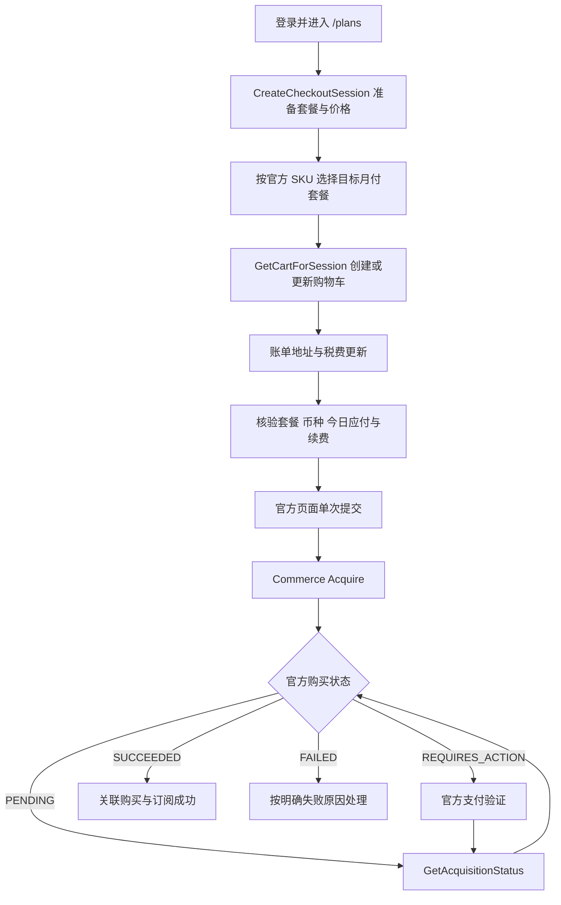

# Grok 官方 Commerce 页面实查（2026-10-13）

本文件保留实施前的只读实查证据。随后用户授权“开始调整”，新版目录与 Commerce 分支已经实现，聚焦回归 197 项通过；实施状态与资金边界见 [实施记录](grok-bundle-cdk-proposal-20261013.md)。下文的“当前实现”“缺口”描述的是审查时的旧代码，不能作为最终实现状态。

## 结论与范围

已在 Grok 官网实际打开 `/plans`，由用户完成登录，然后单次选择 Premium 并查看实际结账弹窗。新页面在 `https://grok.com/plans` 内使用 Commerce 结账组件和 Stripe Payment Element；并未跳转到 hosted Stripe。现有代码已经直接打开 `/plans`，此次失败需要适配新的完整结账分支，不能只修套餐名称或再添加一个固定跳转地址。

本次是只读流程审查。没有填写银行卡或账单地址，没有勾选订阅条款，没有点击付款。付款后的状态与幂等机制依据当前官方前端代码分析，尚未通过真实支付验证。充值运行代码未在本次审查中修改。

## 日志对应的两类失败

- `hoaqne5c`：两个代理尝试均为 HTTP 599，浏览器连通性检查也失败；未到达 Grok 登录和套餐识别。
- `k3sj8z3p`：`proxy=no`，官方账号接口已确认登录。代码等待旧版 SuperGrok 精确入口 12 秒后报 `GROK_ENTRY_MISSING`。实际页面使用 Premium 名称和新版组件，因此此次失败发生在入口识别；没有提交支付。

## 实际套餐组件

### 更正：显示等级映射不代表新旧商品等价

2026-10-13 进一步核对官方 [The X Subscription 概览](https://docs.x.ai/x-subscription/overview) 与 [价格说明](https://docs.x.ai/x-subscription/pricing)：Plus/Premium/Super/Ultra 是新的 The X Subscription 组合订阅，包含 Grok、Cursor、X，并采用共享每周用量池。旧 SuperGrok、Cursor、X Premium 订阅可以继续，切换是可选的。切换时选中的旧订阅会取消、按未使用时间退款，并开始新账期；账号统一不可撤销。

因此，上一版把旧套餐键到新显示名的映射表述为套餐对应，容易被理解为商品完全相同，需要更正。这个映射只能用于理解官方组件中的等级名称，不能据此转换旧 CDK、复用商品标识或认定旧价就是新商品应付。新旧套餐的 CDK 调整方案见 [新组合订阅与 CDK 方案](grok-bundle-cdk-proposal-20261013.md)。

官方前端导出的 `UNIFIED_PLAN_NAMES` 给出下列等级键到统一订阅显示名的映射；表内旧键不是已证实可直接迁移的旧商品标识：

| 官方沿用的等级键 | 新组合订阅显示名 | 本次页面显示的月付价格 |
| --- | --- | --- |
| `supergrok_lite` | Plus | USD 8/月 |
| `supergrok` | Premium | 首月 USD 15，随后 USD 30/月 |
| `supergrok_plus` | Super | 首月 USD 50，随后 USD 100/月 |
| `supergrok_heavy` | Ultra | 首月 USD 100，随后 USD 200/月 |

官方文档标价分别为月付 USD 8/30/100/200、年付 USD 80/300/1000/2000，均不含销售税。表中首期优惠是本次页面的展示结果，优惠资格、地区、税费和最终购物车仍需逐次核验。尤其 Lite/Heavy 的展示基础价与现有系统配置的 10/300 不同，不能在适配时静默改写业务价格。

实际 DOM：

- 计费周期是 `radiogroup`，可见月付控件为 `role=radio`、文字“每月”、`aria-checked=true`；还存在配套的镜像 input，不能把两个节点视为两个有效入口。
- 套餐区域为 `ul[role=list]`，每个套餐位于一个 `li`；标题是普通 div，未使用旧逻辑要求的 h1/h2/h3。
- CTA 没有旧的 `plan-card-*` / `plan-cta-*` test ID。多个卡片都显示“领取优惠”。
- Premium 本次 CTA 的语义标签为 `订阅 Premium 每月, 最受欢迎`，并携带 `data-sku-id`。英文或优惠描述可变，需结合套餐、周期和官方 SKU 元数据确认。
- 本次观察到的 SKU 为 `sku_iFHd43ge7daR`，仅作为证据，不能硬编码为所有账号、地区和日期的通用 SKU。

## 登录后实际结账结构

弹窗从套餐选择切换成“结账”，URL 保持 `/plans`。内部包含：

1. 官方账单表单。国家/州使用 XDS 自定义选择器，触发器为 `button[role=combobox][data-slot=xds-select-trigger]`；展开后为 `role=listbox` 和 `role=option`。配套的国家 input 是状态镜像，不能把直接填这个 input 当作选择国家。
2. 地址自动补全输入为 `input[role=combobox][name=addressLine1]`，`autocomplete="billing address-line1"`。官方代码在选择建议、手动输入或非空地址失焦后展开城市、州、邮编等字段；初始未出现的字段不能直接认为是可选。
3. Stripe Payment Element iframe 负责卡号、有效期、CVC；钱包 iframe 和银行卡转账选项同时存在，应限定银行卡分支，避免误选其他支付方式。
4. `aside.x-commerce-summary` 展示所选套餐、优惠、续费、税费和今日应付。实查 Premium 显示 USD 15.00/月 1 个月，之后 USD 30.00/月；预计税费为“输入地址以计算”，今日到期 USD 15.00，并注明适用税费另计。
5. 订阅条款与自动续费复选框。
6. “订阅并付款”按钮是 `type=button`，没有旧的 hosted Stripe submit test ID；未完成表单时 disabled。

Stripe 暴露了只读 WebMCP `get_order_summary`。本次返回 USD、live mode、存在后续收费，但 `totalAmount=null`；不能据此确认最终应付，也不能用它代替 Commerce 购物车与可见订单摘要的核验。

## 当前官方请求与状态架构

本次实际资源/请求清单中观察到：

- `commerce.prepurchase.v1.PrePurchaseService/CreateCheckoutSession`
- `commerce.prepurchase.v1.PrePurchaseService/GetCartForSession`
- `commerce.billing.v1.AcquisitionService/ListPaymentMethods`
- `commerce.subscription.v1.EntitlementService/GetEntitlements`
- `commerce.subscription.v1.SubscriptionService/GetSubscriptions`
- `commerce.subscription.v1.SubscriptionService/GetLegacySubscriptions`

`CreateCheckoutSession` 在套餐弹窗初始化时就会发生；只在点击套餐后开始监听会漏掉本次会话准备。官方内部还有 `/com/overlay/subscribe` 路由，但没有证据表明它是可以绕过会话初始化的固定付款链接。`/plans` 仍然是已验证的直接入口。

当前官方前端代码包含的后续链路如下；本次未执行付款阶段：

官方 cart 解码要求 `cartId`、`subtotal`、`total`、`expiresAt`；价格 money 使用 `currencyCode` 和 `unitMicros`，不是直接按分解析。选项包含 SKU/价格标识；购物车可包含税费和 `chargeSchedule`，适合分别核验首期及后续收费。

官方 `Acquire` 请求关联 `cartId` 并包含 `idempotencyKey`；结果按 `purchaseId` 继续查询。官方解码只在 SUCCEEDED 且带 `subscriptionId` 时构造成功；PENDING 和 REQUIRES_ACTION 继续处理，FAILED 需要错误详情。支付适配应观察官方页面产生的请求与响应，不能自行拼接私有接口请求或盲目重发。

官方切流代码同时支持 commerce、legacy、pending，账号的历史订阅与 rollout 状态会影响分支。旧版 hosted Stripe 路径仍需保留，与新版 Commerce 分开确认。

## 对照当前实现的缺口

| 当前实现 | 实际页面/架构 | 必要调整 |
| --- | --- | --- |
| `pricing-checkout-grok.js` 按旧标题、test ID 和旧按钮标签定位 | 新显示名、普通 div、带 SKU 的 CTA | 识别两种官方页面，关联目标套餐和动态 SKU；不按位置或泛化 CTA 点击 |
| 月付匹配 Monthly/按月/月付 | 可见 radio 为“每月”，有镜像节点 | 支持实际周期控件并验证选中状态 |
| 点击后监听 `/rest/subscriptions/subscribe/new` | 新会话初始化早于点击，随后 GetCartForSession | 从导航前开始观察；按页面、会话、SKU、购物车版本关联 |
| 只接受 `checkout.stripe.com/c/pay/cs_*` | 新版仍在 `grok.com/plans` 内嵌 Elements | 独立的新结账契约；保持旧分支的地址限制 |
| 固定旧套餐名，基础价格与最终应付均等于配置金额 | 首期优惠、续费与税费分别展示 | 分别验证 SKU、周期、币种、首期 total、续费与税费；不放宽为任意金额 |
| 原生 select 与无 billing 前缀的 autocomplete | XDS 国家/州控件、billing 前缀、动态地址字段 | 操作可见官方控件；等待字段展开与税费/购物车更新后读回 |
| `button[type=submit]`、hosted Stripe `payment_pages` 结果 | `type=button`，Commerce Acquire/购买状态 | 唯一官方提交按钮，单次提交，按 cartId/purchaseId 观察结果 |

## 优化实施顺序

先建立 legacy/commerce 分支与新的结账契约，再适配套餐选择、动态账单、金额核验、付款和购买状态。身份、套餐、金额、会话和结果相关性应贯穿整条链路，避免入口修改后又在后续步骤错误重试。

提速采用官方请求完成和 UI 就绪状态驱动：响应已确认且组件可操作时立即推进，挂起时输出具体阶段与诊断，保留有界超时。不要用固定 sleep、全页 networkidle、重复点击或更短的总超时替代就绪判断。未知支付结果仍停止自动换卡与重试。

回归测试需要复现此次实际 DOM：普通 div 标题、多卡片相同 CTA、每月 radio 镜像节点、初始化早于点击的会话、新版原地结账、自定义国家/州、初始隐藏地址字段、首期 15/续费 30、地址更新税费、`type=button`、不同购物车和购买结果的隔离。此前 128 项通过只能证明既有模拟场景，不证明新版 Commerce 已适配。

## 证据

- [The X Subscription 概览](https://docs.x.ai/x-subscription/overview)，页面标注更新于 2026-10-12：新组合订阅、可选切换、旧订阅取消退款、新账期、账号统一不可撤销。
- [The X Subscription 价格](https://docs.x.ai/x-subscription/pricing)，页面标注更新于 2026-10-11：四个付费档位的月付/年付标价、旧计划继续、税费另计。
- [Bundled Subscription Terms of Service](https://x.ai/legal/bundled-subscription-terms?us=unified)，页面标注更新于 2026-10-07：组合订阅的交易主体、续费与条款；不是旧产品等价的证明。
- 用户上传日志：`/Users/wangyongchao/.codex/attachments/edcbd96f-77b1-4c12-8d16-2fbc947f92fa/已粘贴的文本.txt`。
- 实查截图：`/tmp/kc-grok-checkout-audit-20261013.jpg`。
- 本机已保存公开官方脚本目录：`/tmp/kc-grok-assets`。关键脚本：`0zy_g08-bek5_.js`（套餐名称）、`2ze3j78ah8x53.js`（切流）、`10cb12a5u7l9x.js`（Commerce 请求/结果解码）、`3zbcpuxf2xr0-.js`（套餐组件）、`0zg46z3ega5dr.js`（订阅弹窗）、`3-orbqjxdv9og.js`（结账面板）、`27l-4x7xe0rsm.js`（地址与 XDS 控件）。

只读检查阶段没有更改充值运行代码、重启服务或运行新测试；上述页面行为通过实际登录后的 DOM、截图与请求资源清单验证。后续实现和隔离测试另见实施记录，仍未进行真实扣款、账号统一或订阅迁移。
